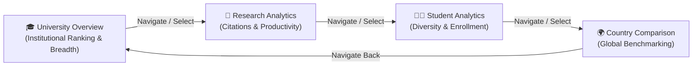
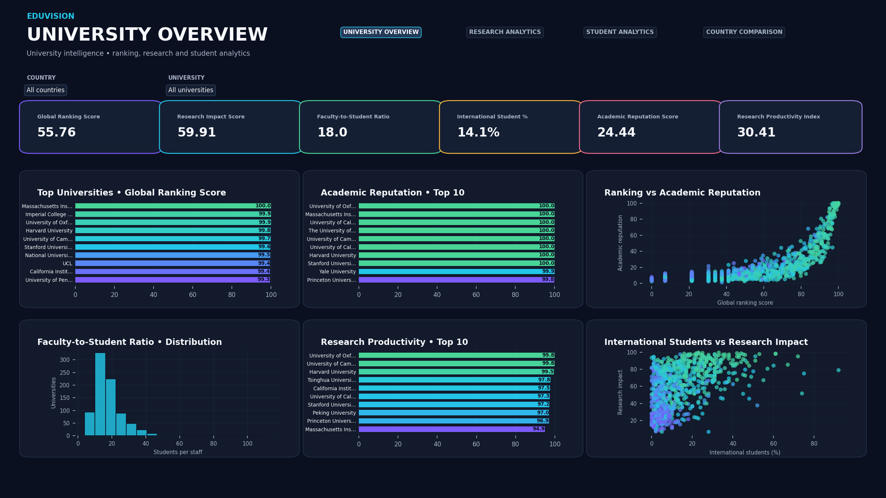
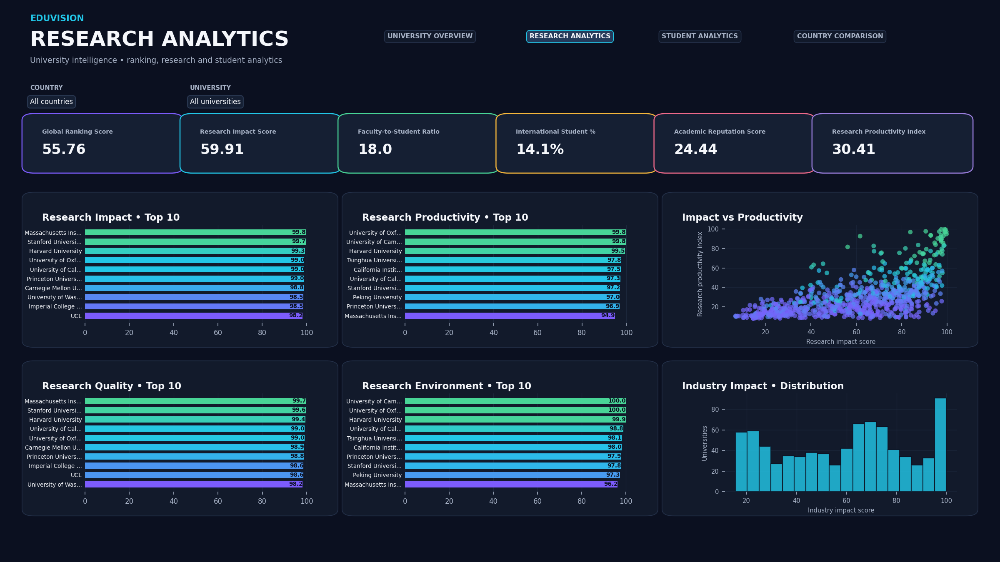
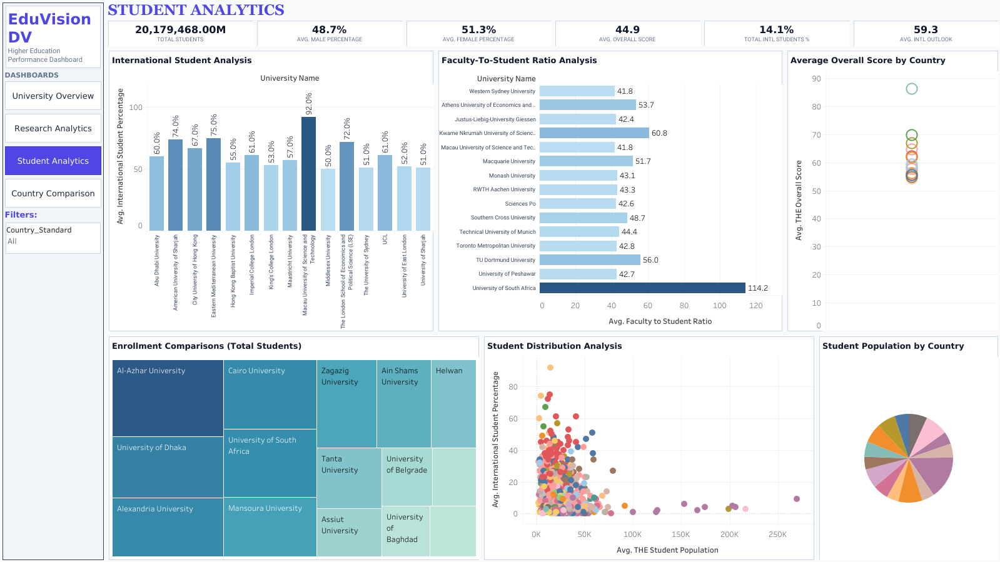
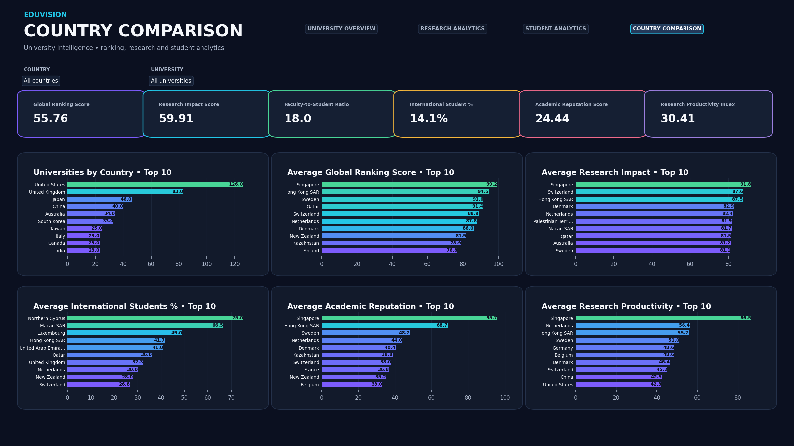
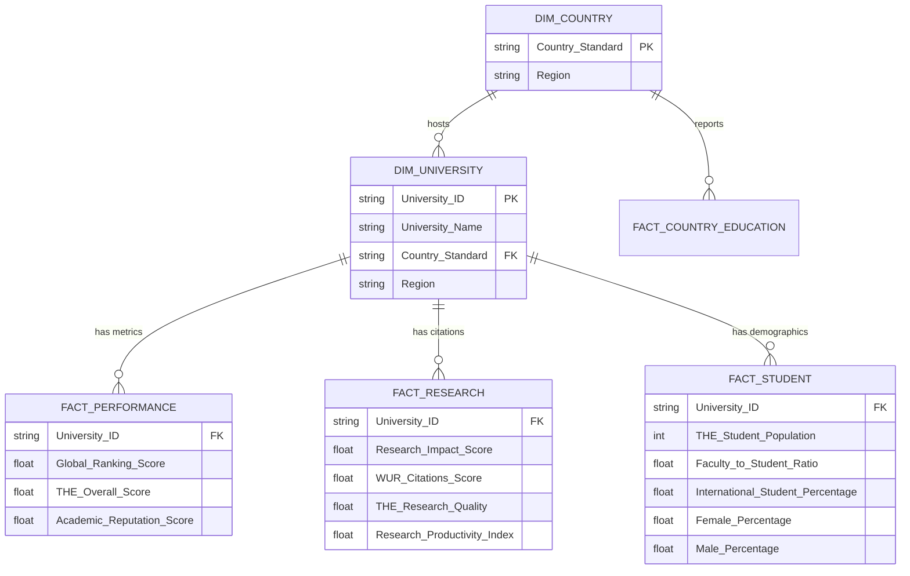
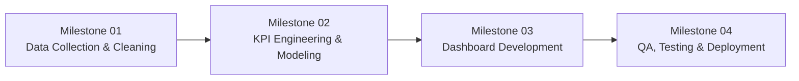

# EduVision_DV: Higher Education Intelligence System for Institutional Performance & Academic Excellence Analysis

[](https://public.tableau.com/app/profile/banka.charishma/viz/eduvision_prototype_17901814682140/ResearchAnalytics?publish=yes)
[](https://www.python.org/)
[](LICENSE)
[]()

> A higher education analytics project that unifies global university ranking datasets (QS, Times Higher Education, World University Rankings) and World Bank education indicators into a single, verified Tableau packaged workbook (`EduVision_DV.twbx`) featuring **four interconnected dashboards**, 24 enterprise KPI scorecards, dynamic navigation, and an auditable 6-stage data pipeline.

---

## 🚀 Live Interactive Dashboard
📊 **Tableau Public Workbook:** [Open EduVision_DV on Tableau Public](https://public.tableau.com/app/profile/banka.charishma/viz/eduvision_prototype_17901814682140/ResearchAnalytics?publish=yes)

The finalized Tableau workbook is published as a cloud-hosted, fully interactive analytics suite featuring real-time filtering, cross-highlighting, and instant navigation.

---

## 🧭 Dashboard Suite Navigation Map

EduVision_DV connects all views with dual persistent navigation: a **Left Sidebar Menu** and a **Top Quick-Jump Navigation Bar** utilizing native Tableau navigation actions.



---

## 📊 The Four Production Dashboards

### 1. 🎓 University Overview
*Macro-level institutional standing, academic reputation, and global geographic distribution.*
- **Core Scorecards (6 KPIs):**
  - **Avg Global Ranking:** `55.8` standardized percentile score
  - **Avg Research Impact:** `59.9` citation influence index
  - **Avg Faculty-Student:** `18.0` student-to-academic-staff ratio
  - **Avg Intl Students %:** `14.1%` global international student share
  - **Avg Academic Rep:** `24.4` global peer reputation score
  - **Avg Research Prod:** `30.4` research productivity benchmark
- **Visual Analytics:** Top Universities by Global Ranking Score (Treemap), Academic Reputation Rankings Table, Average Global Ranking by Country (Bubble Chart), Faculty-to-Student Ratio Analysis, Research Impact vs. Productivity Scatter Plot, Universities by Country World Map.



---

### 2. 🔬 Research Analytics
*In-depth evaluation of scholarly output, citation authority, research quality, and industrial collaboration.*
- **Core Scorecards (6 KPIs):**
  - **Avg Research Impact:** `59.9` overall scholarly authority
  - **Avg Citations Score:** `56.7` normalized citation authority
  - **Avg Research Quality:** `63.3` THE research quality benchmark
  - **Avg Environment:** `31.1` research ecosystem index
  - **Avg Industry Impact:** `59.4` commercial collaboration & income
  - **Avg Research Prod:** `30.4` scholarly output volume
- **Visual Analytics:** Top Universities by Research Impact Score (Bar Chart), Research Quality Comparison (Bubble Chart), Average Research Impact by Country World Map, Research Environment Rankings, Citations vs. Research Productivity Correlation View, Average Industry Impact by Country Trendline.



---

### 3. 👩‍🎓 Student Analytics
*Student demographics, enrollment capacity, gender parity, and international student diversity.*
- **Core Scorecards (6 KPIs):**
  - **Total Students:** `20,179,468.00M` total FTE student body
  - **Avg Male Pct:** `48.7%` average male enrollment ratio
  - **Avg Female Pct:** `51.3%` average female enrollment ratio
  - **Avg Overall Score:** `44.9` composite score
  - **Total Intl Student Pct:** `14.1%` global student mobility
  - **Avg Intl Outlook:** `59.3` internationalization index
- **Visual Analytics:** International Student Percentage Bar Chart, Faculty-to-Student Ratio Distribution, Enrollment Comparisons by Total Students (Treemap), Student Distribution Analysis (Scatter Plot), Student Population by Country Breakdown.



---

### 4. 🌍 Country Comparison
*Macro cross-national higher education performance and regional system comparisons.*
- **Core Scorecards (6 KPIs):**
  - **Avg Global Ranking:** `55.8` national aggregate ranking
  - **Avg Research Impact:** `59.9` scholarly citation influence
  - **Avg Academic Rep:** `24.4` national peer reputation score
  - **Avg Research Prod:** `30.4` national research output index
  - **Avg Intl Students %:** `14.1%` cross-border student share
  - **Avg Faculty-Student:** `18.0` national teaching capacity ratio
- **Visual Analytics:** Average Global Ranking Score by Country (Bar Chart), Average Research Impact Score by Country (Bubble Chart), Academic Reputation Benchmarking (Treemap), Research Productivity Index by Country Trend, International Student % Distribution (Box Plot), Faculty-to-Student Ratio Geographic Map.



---

## 🔑 Key Performance Indicators (KPIs)

| Metric | Source / Formula | Scale / Unit | Purpose & Business Value |
| :--- | :--- | :--- | :--- |
| **Global Ranking Score** | Normalized inverted rank: `(1 - (Rank - 1)/(Max - 1)) * 100` | `0 – 100` | Standardized comparative global standing |
| **Overall Score** | Multi-pillar composite institutional performance | `0 – 100` | Holistic institutional academic excellence |
| **Academic Reputation** | Global peer academic survey reputation score | `0 – 100` | International academic prestige and authority |
| **Research Impact** | Citations and research quality composite index | `0 – 100` | Scientific authority and scholarly citation influence |
| **Faculty-to-Student Ratio** | Derived: FTE Students per Academic Staff Member | Ratio (Float) | Teaching capacity and learning environment |
| **Research Productivity** | Scholarly output volume normalized by staff count | `0 – 100` | Research efficiency and academic productivity |
| **Female Student %** | Extracted from WUR ratio: `Female / (Female + Male) * 100` | Percentage (`%`) | Institutional gender diversity benchmark |
| **Male Student %** | Extracted from WUR ratio: `Male / (Female + Male) * 100` | Percentage (`%`) | Institutional gender diversity benchmark |
| **International Student %** | Ratio of international enrollment to total student body | Percentage (`%`) | Global student mobility and attraction |

---

## 🏗️ Data Architecture (Dimensional Star Schema)

The analytical data model organizes all entities into dedicated fact and dimension tables keyed on `University_ID` and `Country_Standard`:



---

## 🔄 End-to-End ETL Pipeline

1. **Step 0: Raw Ingestion:** 1,503 QS + 867 THE + 812 WUR + 55,918 World Bank records loaded as UTF-8 dataframes.
2. **Step 1: Entity Resolution & Master Anchor:** Standardized on QS 2025 as the single source of truth for institution definitions, correcting regional tags and eliminating duplicate keys.
3. **Step 2: Alias Dictionary & Entity Matching:** Harmonized disparate university naming conventions (e.g. acronyms vs full legal names) through alias dictionaries with country-level scoping.
4. **Step 3: Cascaded Metrics:** Constructed research and student metrics with fallback strategies (THE primary, WUR secondary) to maintain high data integrity.
5. **Step 4: KPI Computation:** Derived normalized scores, gender percentages, and completeness counts across 58 columns.
6. **Step 5: Hyper Extract Generation:** Generated a production-grade Tableau Hyper extract (`Extract.Extract` schema) bundled into `EduVision_DV.twbx`.

---

## 🗂️ Project Milestones



- **Milestone 01 — Data Collection & Cleaning:** Raw data audits, missing value handling, and institution standardization scripts (`data_collection.py`).
- **Milestone 02 — KPI Engineering & Planning:** Metric definitions, derived calculation scripts (`calculate_kpis.py`), and storyboard wireframes.
- **Milestone 03 — Dashboard Development:** Interactive Tableau workbook design, Light Mode card containers, and Hyper database extraction.
- **Milestone 04 — Testing, Verification & Delivery:** Tableau Public extract verification, XML schema DTD validation, comprehensive QA testing checklists, and documentation.

---

## 📁 Repository Structure

```
EduVision_DV/
├── Assets/                                 # High-resolution dashboard screenshots & visual assets
│   ├── UNIVERSITY_OVERVIEW.png
│   ├── RESEARCH_ANALYTICS.png
│   ├── STUDENT_ANALYTICS.png
│   └── COUNTRY_COMPARISON.png
│
├── Dim_&_Fact_Datasets/                    # Star schema dimensional and fact tables
│   ├── dim_university.csv
│   ├── dim_country.csv
│   ├── fact_performance.csv
│   ├── fact_research.csv
│   ├── fact_student.csv
│   └── university_kpi_dataset.csv          # Master 58-column analytical dataset
│
├── Milestone 01/                           # Milestone 01: Ingestion & Auditing
│   ├── Deliverables/                       # Data collection & cleaning reports
│   ├── Raw Datasets/                       # Raw input files (QS, THE, WUR, World Bank)
│   └── Script/                             # Data collection & cleaning scripts
│
├── Milestone 02/                           # Milestone 02: KPI Engineering
│   ├── Deliverables/                       # Storyboard PDF & KPI formulas
│   ├── KPIs Dataset/                       # Computed KPI dataset
│   └── Script/                             # Entity resolution & metric scripts
│
├── Milestone 03/                           # Milestone 03: Visual Analytics
│   └── Deliverables/
│       ├── EduVision_DV.twbx               # Master packaged Tableau workbook (With Navigation)
│       └── Dashboard_Design_Guide.md
│
├── Milestone 04/                           # Milestone 04: QA, Testing & Final Delivery
│   └── Deliverables/
│       ├── Dashboard_Testing_Report.md     # Extract and XML test cases
│       ├── Dashboard_guide.md              # End-user navigation guide
│       ├── Data_Sources.md                 # Full dataset attribution
│       ├── KPI_Defination.md               # Mathematical formulas
│       ├── QA_Checklist.md                 # Final verification checklist
│       └── Project_Structure.md
│
├── Presentation (PPT)/                     # Executive presentation deck
│   └── Presentation - EduVision_DV.pptx    # Complete 10-slide PowerPoint presentation
│
├── .gitignore                              # Git exclusion rules
├── LICENSE                                 # MIT License
└── README.md                               # Project documentation (this file)
```

---

## 🛠️ Tech Stack & Requirements

- **Business Intelligence & Visual Analytics:** Tableau Desktop / Tableau Public (v2020.4+)
- **Data Engineering & Scripting:** Python 3.10+, Pandas, NumPy
- **Extract & Storage Engine:** Tableau Hyper API (`tableauhyperapi`)
- **Presentation Engineering:** `python-pptx`

---

## 🧪 Testing & Verification Summary

- **Extract Compliance:** Bundles full 58-column `.hyper` extract (`Extract.Extract` schema), satisfying Tableau Public requirement (0 errors on publishing).
- **Zero Schema Load Errors:** XML validated against Tableau DTD structure.
- **Scorecard Integrity:** Confirmed 24 out of 24 KPI scorecards render with active numbers across all 4 dashboards.
- **1-Click Navigation:** Interactive sidebar and header buttons verified functional in Tableau.

---

## 📄 License & Attribution
This project is open-source and released under the [MIT License](LICENSE).  
Data sourced from Quacquarelli Symonds (QS), Times Higher Education (THE), Center for World University Rankings (WUR), and The World Bank.
